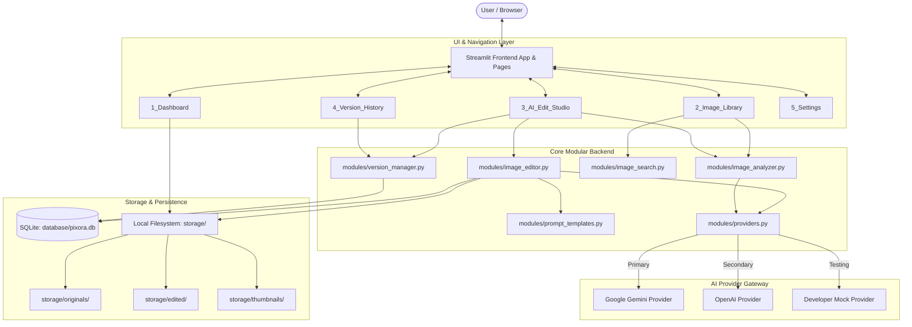

# PIXORA AI — AI-Powered Generative Image Editing Platform

> **"Your imagination. Edited by AI."**  
> A production-grade, full-stack visual creative studio built with Python, Streamlit, Google Gemini (`google-genai`), OpenAI, and SQLite.

[](https://www.python.org/)
[](https://streamlit.io/)
[](https://aistudio.google.com/)
[](https://platform.openai.com/)
[](https://pytest.org/)
[](LICENSE)

---

## 1. Problem Statement

Traditional image editing software (Photoshop, GIMP) requires steep learning curves, intricate manual selections, and hours of masking. Existing consumer AI image generators often generate entirely new images from scratch rather than modifying the user's specific source photograph.

**PIXORA AI** solves this by delivering an **image-first, prompt-guided editing experience**:
- Upload your real photograph (portrait, product, landscape, vehicle).
- Instruct the AI in plain English (e.g., *"Replace the background with a modern luxury apartment while keeping the person exactly the same"* or *"Make the car color matte black"*).
- The platform preserves subject identity, composition, and perspective while generating genuine visual modifications.
- Every edit is versioned non-destructively, allowing users to inspect chronological snapshots and revert without erasing subsequent iterations.

---

## 2. Key Features

- **Functional Image Library:** Upload JPG, PNG, and WEBP images up to 15MB. Real-time file integrity validation, dimension extraction, and thumbnail generation.
- **AI Scene Understanding & Captioning:** Automatically analyzes uploaded photos using Gemini Vision or GPT-4o Vision to extract subject, scene, lighting, and composition into searchable text.
- **Natural-Language Generative Editing:** Dispatches source images and compiled prompts to official generative APIs (`google-genai` and `openai`), receiving and decoding actual image modifications.
- **16+ Built-in Studio Presets:**
  - *Background:* Clean background removal, background replacement, shallow depth-of-field bokeh blur, studio cyc-wall backdrop.
  - *Object Editing:* Selective object removal (inpainting), object addition, object replacement, person removal, photographic cleanup.
  - *Style & Lighting:* Quality enhancement, 35mm cinematic grading, 3-point studio lighting, fine-art B&W, warm golden hour, cool twilight, commercial e-commerce product showcase.
- **Before-and-After Comparison:** Side-by-side visual workspace comparing original source with the active working edit.
- **Audit-Grade Version History & Revert:**
  - Original upload automatically stored as Version 1.
  - Every successful edit creates an immutable, sequentially numbered version snapshot with timestamp and thumbnail.
  - **Non-Destructive Revert:** Roll back to any earlier version (e.g. from v4 to v2) without erasing newer versions.
- **Natural Language Image Search:** Search image collections with natural phrases (e.g. *"Show me beach photos"*, *"Find images with cars"*). Supports vector semantic embeddings with an SQLite FTS/keyword scoring fallback.
- **Provider Abstraction:** Hot-swap between Google Gemini, OpenAI, and Developer Mock mode without modifying UI or database logic.
- **Dark Creative SaaS UI:** Custom design system built with dark charcoal hues, violet/indigo accents, and responsive layout.

---

## 3. Technology Stack

| Layer | Technologies |
|---|---|
| **Frontend** | Python Streamlit 1.57, Custom CSS Design System |
| **Backend & Core** | Python 3.10+, Pillow 10.4+, Python-Dotenv |
| **Primary AI Engine** | Google Gemini (`google-genai` SDK), Imagen 3.0, Gemini 2.5/1.5 Flash Vision |
| **Secondary AI Engine**| OpenAI Python SDK, GPT-4o Vision, DALL-E / Images Edit API, text-embedding-3-small |
| **Database & Search**| SQLite3 with Foreign Keys, Performance Indexes, and FTS Full-Text Search |
| **Testing** | Pytest (21 automated unit and integration tests) |

---

## 4. Application Architecture



---

## 5. Folder Structure

```
PIXORA AI/
│
├── app.py                      # Main entrypoint, router, and hero landing page
├── requirements.txt            # Locked project dependencies
├── README.md                   # Comprehensive documentation
├── .env.example                # Environment template
├── .env                        # Local configuration & credentials (git-ignored)
├── .gitignore                  # Git protection for keys, storage, and cache
├── config.py                   # Central configuration & directory initializer
├── seed_demo_data.py           # Demo dataset generator for instant evaluation
│
├── modules/                    # Modular backend architecture
│   ├── __init__.py
│   ├── database.py             # SQLite schema, CRUD, and transaction manager
│   ├── image_storage.py        # Image validation, Pillow resizing, thumbnails
│   ├── prompt_templates.py     # Prompt engineering & specialized presets
│   ├── providers.py            # Gemini, OpenAI, and Mock provider gateway
│   ├── image_analyzer.py       # Vision API captioning & scene understanding
│   ├── image_editor.py         # AI image-to-image execution coordinator
│   ├── image_search.py         # Semantic vector & keyword hybrid search
│   ├── version_manager.py      # Non-destructive versioning & rollback logic
│   ├── ui_components.py        # Reusable Streamlit UI components & layout
│   └── utilities.py            # Formatting, Base64, and vector math helpers
│
├── pages/                      # Multi-page Streamlit interface
│   ├── 1_Dashboard.py          # Platform analytics, activity feed, disk allocation
│   ├── 2_Image_Library.py      # Gallery grid, search bar, filter pills, card actions
│   ├── 3_AI_Edit_Studio.py     # Core studio: comparison, presets, prompts, generation
│   ├── 4_Version_History.py    # Chronological timeline, snapshots, revert operations
│   └── 5_Settings.py           # Provider switcher, API key management, connection tester
│
├── assets/
│   └── custom.css              # Custom dark SaaS theme stylesheet
│
├── storage/                    # Persistent image storage (git-ignored)
│   ├── originals/              # Unmodified source uploads (v1)
│   ├── edited/                 # Generated PNG edit versions (v2, v3, ...)
│   └── thumbnails/             # High-performance WEBP thumbnails
│
├── database/
│   └── pixora.db               # SQLite database file
│
└── tests/                      # Automated test suite
    ├── test_database.py        # DB schema, cascades, and version numbering
    ├── test_version_manager.py # Chronological history and revert integrity
    ├── test_prompt_templates.py# Preset formatting & prompt validation
    ├── test_storage.py         # Upload validation, format handling, thumbnails
    ├── test_validation.py      # Missing credentials & mock provider workflows
    └── test_search.py          # Natural language search & fallback ranking
```

---

## 6. Installation & Setup

### Prerequisites
- Python 3.10 or higher
- Git

### 1. Clone the repository
```bash
git clone https://github.com/your-username/pixora-ai.git
cd pixora-ai
```

### 2. Create and activate a virtual environment
**On Windows:**
```bash
python -m venv .venv
.venv\Scripts\activate
```

**On macOS / Linux:**
```bash
python3 -m venv .venv
source .venv/bin/activate
```

### 3. Install dependencies
```bash
pip install -r requirements.txt
```

### 4. Configure environment variables
Copy `.env.example` to `.env`:
```bash
cp .env.example .env
```
Edit `.env` with your API credentials:
```ini
AI_PROVIDER=gemini
GEMINI_API_KEY=your_google_gemini_api_key_here
GEMINI_IMAGE_MODEL=imagen-3.0-capability-001
GEMINI_VISION_MODEL=gemini-2.5-flash

OPENAI_API_KEY=your_openai_api_key_here
OPENAI_IMAGE_MODEL=dall-e-2
OPENAI_VISION_MODEL=gpt-4o-mini
```

> **Tip:** You can also enter and test API keys directly in the app under **5_Settings**.

---

## 7. Running the Application

### Seed Demo Images (Optional)
To instantly populate the studio with sample images, captions, and edit histories:
```bash
python seed_demo_data.py
```

### Launch the Streamlit App
```bash
streamlit run app.py
```
Open your browser to `http://localhost:8501`.

---

## 8. AI Provider Configuration

### Google Gemini (Primary Provider)
1. Get a free API key at [Google AI Studio](https://aistudio.google.com).
2. Uses the official Google GenAI SDK (`google-genai`).
3. For image understanding: uses `gemini-2.5-flash` or `gemini-1.5-flash`.
4. For image editing: uses `client.models.edit_image` or `generate_images` prioritizing Imagen 3 (`imagen-3.0-capability-001`).

### OpenAI (Secondary Provider)
1. Obtain an API key from [OpenAI Platform](https://platform.openai.com/api-keys).
2. For vision understanding: uses `gpt-4o-mini`.
3. For image editing: uses `client.images.edit` with square alpha-padded PNG frames.
4. For semantic search: uses `text-embedding-3-small`.

### Developer Mock Provider (Offline / Testing)
- If you do not have API keys configured, select **Developer Mock Engine** in **5_Settings** or set `AI_PROVIDER=mock`.
- The mock engine deterministically transforms images using Pillow filters (blur, monochrome, grading) and applies a visible watermark badge `[PIXORA MOCK / TEST MODE]`.
- This ensures full verification of the user experience and database integrity without misrepresenting output.

---

## 9. Workflow Explanation

```
┌──────────────┐     ┌───────────────────┐     ┌──────────────────────┐
│  1. Upload   │ ──> │ 2. AI Vision Scan │ ──> │  3. Studio Workspace │
│  Source Photo│     │ (Generates Caption│     │ (Select Preset/Prompt│
└──────────────┐     └───────────────────┘     └──────────────────────┘
                                                           │
                                                           ▼
┌──────────────┐     ┌───────────────────┐     ┌──────────────────────┐
│  6. Revert   │ <── │ 5. Version History│ <── │ 4. Generative Edit   │
│  Rollback    │     │ Snapshot & Audit  │     │ (API Image Output)   │
└──────────────┐     └───────────────────┘     └──────────────────────┘
```

1. **Upload:** User drops an image (JPG, PNG, WEBP). File is validated for integrity, dimensions extracted, thumbnail created, and saved as **Version 1 (Original)**.
2. **Vision Analysis:** The Vision API describes the main subject, setting, and composition. Saved to SQLite for natural language search.
3. **Prompt Selection:** User chooses a preset (e.g., *Remove Background*, *Make Cinematic*) or types a custom command.
4. **AI Generation:** The source image and compiled prompt are dispatched to the configured API. The returned image bytes are validated and written to `storage/edited/`.
5. **Version Tracking:** The edit is registered as **Version N**, linked to its parent, with its prompt, provider, and timestamp recorded.
6. **Revert:** User can inspect any historical version and click "Revert". The active working image is updated without deleting newer versions.

---

## 10. Prompt Engineering Architecture

Located in `modules/prompt_templates.py`:

```
Base Template:
"You are an expert professional image editor. Edit the supplied original image according to the user's instruction.
USER REQUEST: {user_prompt}
INSTRUCTIONS:
1. Use the supplied image as the source image.
2. Make the requested changes accurately.
3. Preserve all unrelated visual elements wherever possible.
4. Maintain realistic lighting, perspective, shadows, proportions, and composition.
5. Maintain identity of subjects unless explicitly requested.
6. Blend newly added objects naturally into the scene.
7. Avoid distortions and artifacts.
8. Return the actual edited image."
```

The system dynamically merges this instruction with specialized prompts for background isolation, inpainting, relighting, and grading.

---

## 11. Automated Testing

Run the complete test suite:
```bash
python -m pytest -v
```

### Test Coverage Summary:
- `test_database.py`: Table schema, image/version insertion, auto-increment version numbering, foreign key cascade deletion.
- `test_version_manager.py`: Chronological history, active version updates, non-destructive rollback preserving future versions.
- `test_prompt_templates.py`: Preset prompt generation, custom injection, rejection of empty inputs.
- `test_storage.py`: Valid format handling, invalid file rejection, corruption check, thumbnail scaling, physical file cleanup.
- `test_validation.py`: Missing API key handling, provider factory selection, MockProvider end-to-end execution.
- `test_search.py`: Natural language query matching against captions and filenames, fallback modes.

---

## 12. Deployment Considerations

### Streamlit Community Cloud
1. Push repository to GitHub (ensure `.env` and `storage/` are in `.gitignore`).
2. Go to [share.streamlit.io](https://share.streamlit.io).
3. Connect repository and set `app.py` as the main script.
4. Add environment variables under **App Settings ➔ Secrets**:
   ```toml
   AI_PROVIDER = "gemini"
   GEMINI_API_KEY = "your-key-here"
   ```

> **Note on Persistent Storage:** Ephemeral containers (like basic Streamlit Cloud) reset local storage on restart. For persistent production hosting, configure AWS S3, Google Cloud Storage, or mount a persistent volume for the `storage/` and `database/` directories.

---

## 13. License

Distributed under the MIT License. See `LICENSE` for more information.
